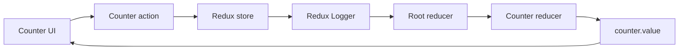

# React + Redux Counter


A small React and TypeScript app demonstrating manual Redux state management. It uses Redux (without Redux Toolkit), React-Redux, and Redux Logger to power a simple interactive counter.

## What it does

- Reads the counter value from the Redux store.
- Increments, decrements, or resets the value with dispatched actions.
- Logs dispatched actions and state changes through Redux Logger.
- Uses TypeScript and CSS Modules alongside Vite's development server.

## Get started

Requirements: Node.js and npm.

Run these commands from this project directory (`react-redux-app`):

```bash
npm install
npm run dev
```

Open the URL printed by Vite in the terminal. It is usually `http://localhost:5173/`; if that port is in use, Vite may print a different one.

Use Vite to run the app. Do not open `index.html` directly or use Five Server: this project needs Vite to transform and serve its TypeScript and React modules.

## Available commands

| Command | Purpose |
| --- | --- |
| `npm run dev` | Start the Vite development server with hot reload. |
| `npm run build` | Type-check the project and create a production build in `dist/`. |
| `npm run lint` | Run Oxlint. |
| `npm run preview` | Serve the production build locally for a preview. Run `npm run build` first. |

## How Redux is connected

The `Counter` component dispatches an action. The store sends it through Redux Logger and the combined reducer; the updated state is selected by the component and rendered again.



The state shape is `{ counter: { value: number } }`.

| Action | Result |
| --- | --- |
| `INCREMENT` | Adds one to the current value. |
| `DECREMENT` | Subtracts one from the current value. |
| `RESET` | Sets the value back to zero. |

## Project structure

```text
react-redux-app/
├── index.html
├── package.json
└── src/
	├── App.tsx
	├── main.tsx
	├── index.css
	├── components/
	│   ├── Counter.tsx
	│   └── Counter.module.css
	└── store/
		├── store.ts
		├── actions/
		│   └── counterActions.ts
		└── reducers/
			├── counterReducer.ts
			└── index.ts
```

`main.tsx` wraps the app in React-Redux's `Provider`. `store.ts` creates the Redux store and installs the logger middleware. The root reducer combines the counter reducer, while `Counter.tsx` connects the UI to the state and actions.

## Troubleshooting

- **Blank page:** Check the terminal for Vite's ready message, then open the exact URL Vite printed. Make sure the command was run from `react-redux-app`, not its parent directory.
- **Port already in use:** Vite may select another port. Use the URL shown in the terminal rather than assuming port `5173`.
- **Need to check the production output:** Run `npm run build`, then `npm run preview` from this directory.
